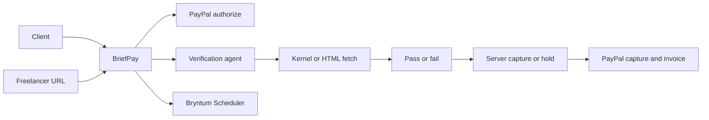

# BriefPay

The client places the fee on a PayPal **authorization hold**. A verification agent checks the freelancer's delivery URL against the brief, and the server captures only after that check passes. A complete button does not release the money.

Built in November 2026 for the PayPal AI Hackathon. This is not licensed escrow. BriefPay creates a PayPal order with `AUTHORIZE` and calls `capture` only after review. An authorization hold usually must be captured or released within about 29 days.

## Judges: how to run

With sandbox keys, scenario A (pass, then capture) and scenario B (fail, and the hold stays) can be reproduced locally or on the deployed URL.

```bash
npm install
cp .env.example .env
# Fill PayPal sandbox keys and, if you have them, an AI key and KERNEL_API_KEY.
npx prisma migrate dev
npx prisma db seed
npm run dev
```

Open http://localhost:3000/briefpay. On this machine nginx also publishes it at https://meganesoftware.cc/briefpay/ and https://www.wordchain.win/briefpay/.

| Variable | Required for | If missing |
| --- | --- | --- |
| `PAYPAL_CLIENT_ID`, `PAYPAL_CLIENT_SECRET`, `NEXT_PUBLIC_PAYPAL_CLIENT_ID` | Sandbox authorize, capture, void, invoice | Set `PAYPAL_MOCK=true` to click through the state machine locally. The screen says it is not a PayPal payment. |
| `PAYPAL_WEBHOOK_ID` | Signed webhooks | Buyer approval still records the hold through `onApprove`. |
| `ANTHROPIC_API_KEY` | Claude Haiku review (`claude-haiku-5-5` unless `AI_MODEL` is set) and the PayPal Agent Toolkit invoice draft | The server still opens the page and judges criteria from what it can see. `OPENAI_API_KEY` or `XAI_API_KEY` can be used instead. |
| `KERNEL_API_KEY` | Cloud browser, including a real 390px check | Falls back to fetching the page HTML. |
| `BRYNTUM_LICENSE_KEY` | Licensed Scheduler build | The public trial package renders the milestone timeline with its trial watermark. |
| `PAYPAL_MERCHANT_EMAIL` | Some sandbox invoice accounts | Omitted unless set. Capture still completes if invoicing fails. |

Do not commit secrets. Sandbox buyer passwords belong in the Devpost private test-account field, not in this repo. Use your own PayPal sandbox personal account as the buyer. The app refuses `PAYPAL_ENVIRONMENT=LIVE`.

Demo logins have no password. Use the role switch:

- Client: `client@demo.com`
- Freelancer: `freelancer@demo.com`

## Architecture



The verification agent can browse. It cannot call PayPal. After a structured pass, server code captures the authorization. A fail never calls capture.

## Demo script

Scenario A, pass and pay:

1. Start as the client and open **Landing page redesign** (seeded, USD 150, four criteria, due in three days).
2. Fund it with PayPal sandbox checkout. The intent is authorize. The job shows an authorization id and an empty capture id.
3. Switch to the freelancer, accept the job, and submit `/demo/pass` (or the absolute URL the form fills in). The pass example link is labeled **Pass example**.
4. Run **Run AI review**. Each criterion should pass. The server captures, the status becomes Captured, and an invoice is recorded when PayPal accepts it.
5. The Bryntum timeline gains Created, Authorization hold, Accepted, Delivery submitted, Verification started, Verification passed, and Captured.

Scenario B, fail and hold:

1. Create a second job with the same criteria, or use a fresh draft, and authorize it.
2. Submit `/demo/fail` (no CTA, one plan, no contact form).
3. Verification fails with evidence. Capture is not called. The authorization remains. The freelancer can submit again after revising.

The client can force a full capture or void the hold from a failed job. Partial payouts are not implemented.

## PayPal setup

1. Create a sandbox REST app in the PayPal developer dashboard.
2. Put the client id and secret in `.env`. Copy the client id to `NEXT_PUBLIC_PAYPAL_CLIENT_ID`.
3. Orders are created with `intent: AUTHORIZE`. After the buyer approves, the server calls `POST /v2/checkout/orders/{id}/authorize` and stores the authorization id. It does not call order capture.
4. On pass, the server calls `POST /v2/payments/authorizations/{id}/capture` with a stable `PayPal-Request-Id`.
5. Cancel calls authorization void. A job that is already captured is refunded instead.
6. The receipt invoice is not a second charge. The note says the capture already happened, and the server records a payment against it.
7. Optional: subscribe a webhook to `https://<your-host>/api/paypal/webhook` for `CHECKOUT.ORDER.APPROVED`, `PAYMENT.AUTHORIZATION.CREATED`, `PAYMENT.AUTHORIZATION.VOIDED`, and `PAYMENT.CAPTURE.COMPLETED`. Signature verification uses `PAYPAL_WEBHOOK_ID`. `CHECKOUT.ORDER.APPROVED` authorizes the order. It does not capture.

When an AI key is present, a separate receipt step uses `@paypal/agent-toolkit` (`context.sandbox: true`, invoice create/get/list only). The server checks the draft amount before send and record-payment. The verification agent does not receive those tools.

## Tools and license

- Next.js, React, TypeScript, Tailwind CSS
- Prisma and SQLite
- Vercel AI SDK. Claude Haiku through `ANTHROPIC_API_KEY`, or OpenAI, or an OpenAI-compatible xAI key
- PayPal Orders v2 authorize/capture/void, Invoicing v2, Webhooks
- `@paypal/agent-toolkit` for the receipt draft
- Kernel (`@onkernel/sdk`) when `KERNEL_API_KEY` is set, otherwise a same-interface HTML fetch
- Bryntum Scheduler trial (`@bryntum/scheduler` aliased to `@bryntum/scheduler-trial`) for the milestone timeline. `npm run dev` and `npm run build` copy the trial script and CSS into `public/bryntum`, which is gitignored so the trial watermark stays out of git.
- APIMatic and Render are optional. This repo does not call APIMatic. SQLite on an ephemeral host resets with the disk.

Code license: MIT. Bryntum Scheduler is commercial software used here via its public trial package. Do not commit a paid license key.

## Local mock

`PAYPAL_MOCK=true` works only when `PAYPAL_CLIENT_ID` is empty. The fund button is labeled as a simulation and writes `MOCK-` ids. It is for UI development, not for the judging demo of PayPal.
